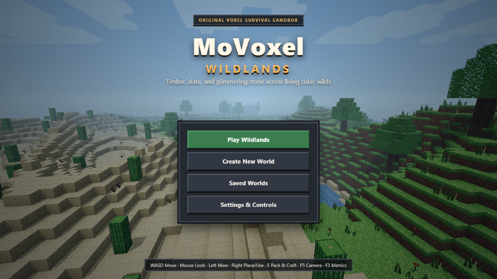
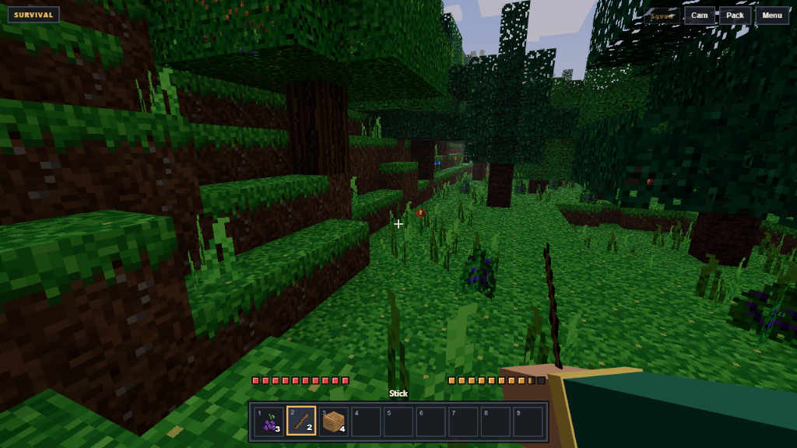
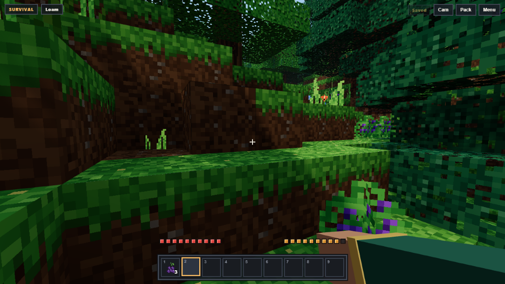
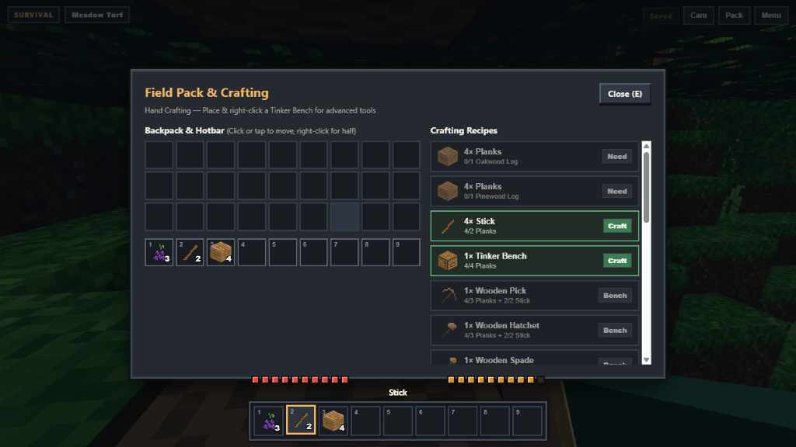

# MoVoxel: Wildlands

**Live Game:** [https://movoxel-wildlands.vercel.app](https://movoxel-wildlands.vercel.app)

**MoVoxel: Wildlands** is an original browser-based 3D voxel survival and building sandbox built with TypeScript, Vite, and Three.js (r187). Explore deterministic procedural worlds with grassy plains, pine and oakwood forests, desert dunes, caves, and wardstone rings while mining blocks, gathering materials, crafting tools, managing survival vitals, and persisting your builds locally in IndexedDB.

## Gameplay Screenshots

| Main Menu (Live 3D Voxel Panorama) | Sunlit Forest Exploration |
|---|---|
|  |  |

| Mining & Block Placement | Field Pack & Crafting |
|---|---|
|  |  |

## Feature Overview

- **Procedural Cubic Worlds**: Seeded 2D and 3D Simplex noise generates multi-biome landscapes (Plains, Pine & Oakwood Forests, Sunbleached Shores), ponds, underground caves, ore veins (*Cinder Ore*, *Rustvein Ore*, *Glimmer Ore*), and *Wardstone* rings off-thread via Web Workers with a main-thread fallback.
- **Chunked Meshing & Lighting**: `16 x 128 x 16` chunk columns cull hidden neighbor faces, separate Opaque/Cutout, Cross Foliage, and Transparent Water geometry passes, and bake 4-level per-vertex ambient occlusion plus sky-exposure lighting.
- **Mining, Building & Crafting**: Raycast block targeting with progress crack overlays, survival drops and pickup, 9-slot hotbar + 27-slot backpack, tool durability, and hand + Tinker Bench crafting recipes.
- **Survival & Atmosphere**: Health and stamina/hunger vitals, dynamic sun/moon sky dome with stars and drifting cubic clouds, twilight fireflies, *Mossback* and *Gloomling* creatures, Creative mode with double-jump flight, and procedural Web Audio SFX.
- **Fixed-Step Physics**: 60 Hz axis-separated AABB voxel collision with render interpolation and crouch edge protection.

## Technology Stack

- **Renderer**: Three.js (`^0.187.0`) WebGL2 / WebGL
- **Language & Build**: TypeScript (`^7.0.2`), Vite (`^8.3.8`)
- **World Generation**: Dedicated ES Module Web Worker (`src/world/generator.worker.ts`)
- **Audio**: Synthesized procedural Web Audio API (`src/audio/audio.ts`)
- **Persistence**: IndexedDB (`movoxel-wildlands`) + `localStorage` (`movoxel-wildlands.settings.v1`)
- **Hosting**: Vercel (static production bundle via GitHub integration)

## Controls

### Desktop (Keyboard & Mouse)

| Input | Action |
|---|---|
| **W / A / S / D** or **Arrow Keys** | Move (layout-independent physical keycodes) |
| **Mouse** (Click canvas to lock pointer) | First-person look & aim (with unlocked-cursor fallback in restricted webviews) |
| **Space** | Jump / Swim up / Double-tap in Creative mode to toggle flight |
| **Left Shift** | Sprint (or fast flight) |
| **Left Ctrl / C** | Sneak / Crouch (edge-safe sneaking, lowers flight) |
| **Left Click (Hold)** | Mine targeted block / Attack creature |
| **Right Click** | Place block / Eat held food / Use Tinker Bench |
| **1 - 9** or **Mouse Wheel** | Select hotbar slot |
| **E** or **I** | Open / Close Field Pack & Crafting |
| **Q** | Toss 1 item from selected hotbar slot |
| **F5** or **V** | Toggle First-Person / Third-Person camera |
| **F3** | Toggle FPS, draw calls, chunks, coordinates, biome & day telemetry |
| **Esc** | Pause / Release pointer lock / Close modal |

### Mobile & Touch Devices

- **Left Virtual Joystick**: Analog movement with radial deadzone; push to outer ring to sprint.
- **Right Touch Region**: Drag anywhere on the right side to look around while moving.
- **On-Screen Action Buttons**: **Mine**, **Place**, **Jump**, **Sneak**, **Fly** (Creative mode), and **Pack**.
- **Hotbar**: Tap any slot directly to switch held items.
- **Orientation Notice**: Non-blocking landscape suggestion banner on narrow portrait viewports with a **Dismiss** button.

## Installation & Local Development

Requires Node.js 20+ (tested on Node 24.22.1 / npm 11.19.1).

```bash
git clone https://github.com/dimasmong/MoVoxel-Wildlands.git
cd MoVoxel-Wildlands
npm ci
```

### Development Commands

```bash
npm run dev        # Start local Vite development server
npm run typecheck  # Run strict TypeScript checking (tsc --noEmit)
npm run build      # Type-check and build static production bundle into dist/
npm run preview    # Preview the built dist/ bundle locally
```

### Production Build

`npm run build` runs `tsc --noEmit && vite build` using `base: './'` and `target: 'es2022'` (`vite.config.ts`). All geometry, textures, icons, shaders, Web Worker code, and audio synthesis are compiled directly into `dist/` with relative asset paths and zero external runtime CDN dependencies.

## How World Saving Works

- **IndexedDB (`movoxel-wildlands`)** (`src/save/db.ts`):
  - `worlds`: World metadata, seed, expedition mode (`survival` or `creative`), player position/orientation/vitals/spawn, inventory stacks, tool durability, world clock, and `version: 1`.
  - `backups`: Previous known-good world snapshot written in the same transaction before updating `worlds`, providing automatic fallback recovery if a primary record fails validation.
  - `chunks`: Sparse per-chunk block overrides (`[localIndex, blockId, ...]`), allowing deterministic terrain regeneration plus fast replay of player block edits across page reloads.
- **Settings (`localStorage`)** (`src/settings.ts`): Stores UI, camera FOV, mouse sensitivity, render distance, quality preset, and audio volume settings under `movoxel-wildlands.settings.v1`.

## Deployment

This project is deployed on Vercel with GitHub integration connected to the `main` branch of `dimasmong/MoVoxel-Wildlands`. Every push to `main` triggers an automatic production build and deployment to:

- **Production URL**: [https://movoxel-wildlands.vercel.app](https://movoxel-wildlands.vercel.app)
- **Framework Preset**: Vite
- **Install Command**: `npm ci`
- **Build Command**: `npm run build`
- **Output Directory**: `dist`
- **Production Branch**: `main`

To deploy manually via the Vercel CLI:

```bash
npx vercel --prod
```

## Architecture Overview

```text
├── docs/screenshots/            # Verified gameplay screenshots
├── index.html                   # App shell & viewport configuration
├── package.json                 # Dependencies & scripts
├── package-lock.json            # Locked npm dependency tree
├── tsconfig.json                # Strict TypeScript settings
├── vite.config.ts               # Vite relative base & ES worker build config
└── src/
    ├── main.ts                  # Application entry point
    ├── settings.ts              # Quality presets & localStorage persistence
    ├── style.css                # HUD, modal, and mobile touch styles
    ├── audio/audio.ts           # Procedural Web Audio synthesizer
    ├── core/                    # Constants, Mulberry32 PRNG, Simplex noise
    ├── world/                   # Block registry, chunks, mesher, worker & world
    ├── render/                  # Pixel atlas, icons, materials, sky, effects, hand
    ├── game/                    # Player AABB physics, DDA raycast, inventory, crafting, AI, loop
    ├── save/db.ts               # Versioned IndexedDB persistence & backup recovery
    └── ui/ui.ts                 # HUD, title screen, settings, inventory & pause modals
```

## Known Limitations

- **Local Persistence Only**: Saved worlds and settings live in browser storage (IndexedDB and `localStorage`) per origin and device; there is no cloud account sync or cross-device world transfer.
- **Single-Player Sandbox**: There is no online multiplayer or server synchronization.
- **Browser Pointer Lock Policies**: Desktop browsers require a canvas click before granting hardware mouse lock; restricted embedded webviews that block Pointer Lock fall back to unlocked-cursor camera aiming while the cursor stays over the canvas.
- **Static Browser Constraints**: Very high render distances on low-powered GPUs or mobile devices can lower frame rates; lowering Render Distance or Quality in **Settings & Controls** restores headroom.
